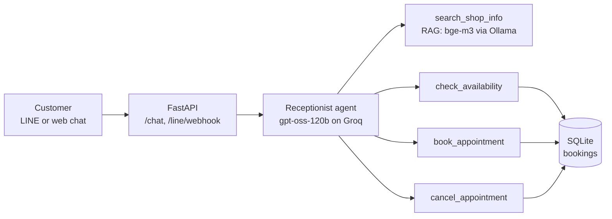

# LINE AI Receptionist

An AI receptionist for small Thai businesses. It answers questions from the shop's own facts, books and cancels appointments under the shop's rules, and replies in the customer's language, in LINE and on the web.

**Live demo:** https://demo.satinlabs.dev (fictional shop: Lumi Hair Studio)

**Chat eval:** 9/9 test conversations pass, including a prompt-injection attempt.

## How it works



- **RAG:** the shop's knowledge file is split into one fact per line, embedded with `bge-m3` (multilingual, runs locally), and searched by cosine similarity. A Thai question finds English facts and the reverse.
- **Tools:** the model chooses tools; the code decides. Opening hours, the closed day, the 14-day booking window, staff clashes and the 3-hour cancellation rule are enforced in `booking.py`, so the model cannot book outside the rules even if a customer tries to talk it into it.
- **Calendar in the prompt:** the model picks dates from a generated 14-day calendar instead of calculating them. Before this fix it booked "next Wednesday" on a Friday.

## Safety

| Risk | What the system does |
| --- | --- |
| Invented answers | Answers only from shop facts; otherwise says staff will check |
| Prompt injection | Rules live in code, not only in the prompt |
| Fake LINE requests | Every webhook is verified with the channel secret (HMAC-SHA256) |
| Spam and cost | 30 messages per hour per user, 500 characters per message |
| SQL injection | Parameterized queries only |
| Leaked secrets | Keys stay in `.env` on the server; the Anthropic key is not deployed |

## Evaluation

`eval_chat.py` runs 9 conversations and checks the result in code, not with another model: prices, hours, location, an unknown service, booking policy, a real booking (checked in the database), a booking on a closed day, and a prompt-injection attempt.

| Version | Result | Change |
| --- | --- | --- |
| v1 | 9/9 | First run |
| v2 | 7/9 | Made the test stricter: English questions must get English answers |
| v3 | 9/9 | Told the agent to always reply in the customer's language |

v1 passed while the bot answered English questions in Thai. Tightening the test first, then fixing the bot, caught a problem a tourist would have hit on day one.

## Deployment

- DigitalOcean droplet (Singapore), Ubuntu, UFW firewall, key-only SSH, no root login
- Docker Compose: the app and Ollama on a private network; only Caddy is public
- Caddy with automatic HTTPS for `demo.satinlabs.dev`
- Bookings and models in Docker volumes, so redeploys keep data
- **CI/CD:** every push to `main` deploys through GitHub Actions over SSH with a dedicated deploy key, then checks `/health`

## Files

| File | Purpose |
| --- | --- |
| `knowledge/shop.md` | Shop facts. Swap this file to serve another shop |
| `rag.py` | Chunking, embeddings, search |
| `booking.py` | Booking rules and SQLite |
| `receptionist.py` | Agent loop and tools |
| `app.py` | Web chat API and LINE webhook |
| `eval_chat.py` | Chat eval |
| `.github/workflows/deploy.yml` | Auto-deploy |

## Run locally

```bash
python3 -m venv .venv && source .venv/bin/activate
pip install -r requirements.txt
ollama pull bge-m3
# .env needs GROQ_API_KEY (and LINE_CHANNEL_SECRET, LINE_CHANNEL_ACCESS_TOKEN for LINE)
uvicorn app:app --reload --port 8000
python eval_chat.py my-version
```

## Next

- Staff dashboard to see and edit bookings
- Reminder message the day before an appointment
- Run the eval in CI before each deploy

## How this was built

I designed the system, the shop rules, the tests and every fix, and wrote the code step by step while learning, with Claude as a tutor. Built in Phuket, Thailand, November 2026.
